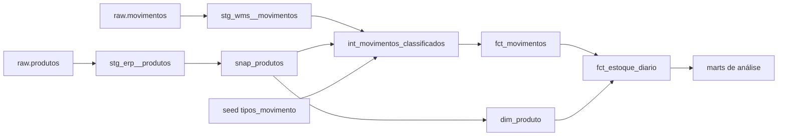
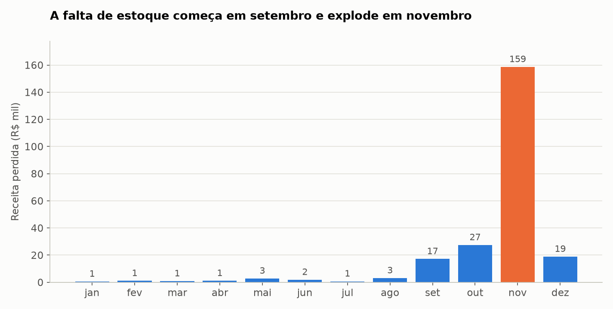
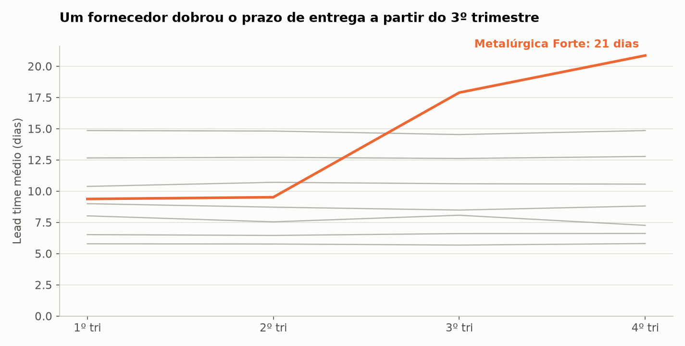
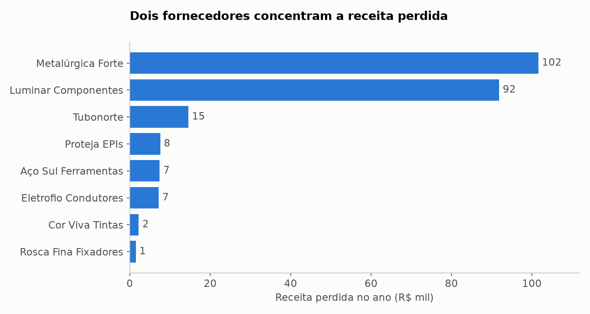
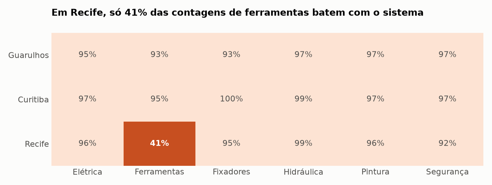
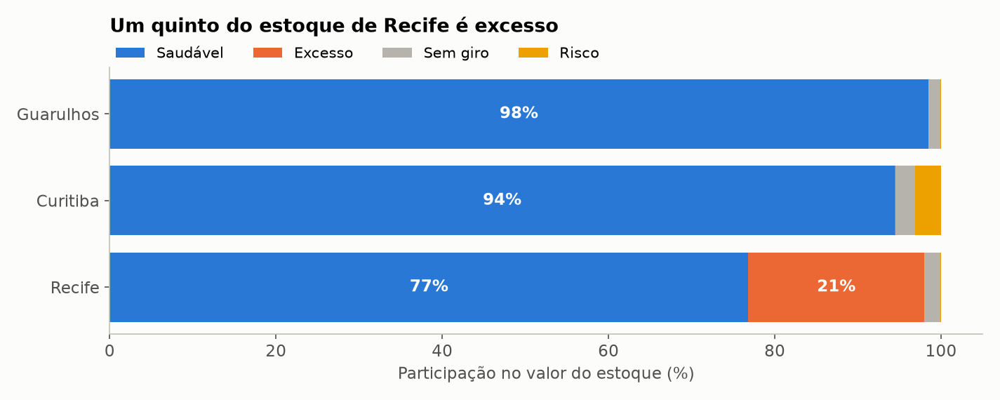
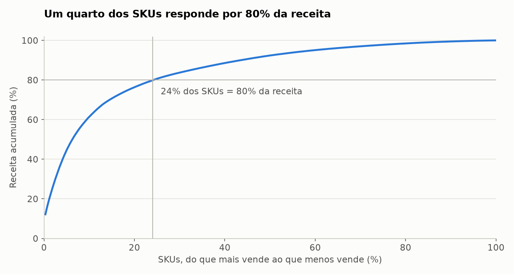

# 08 · Inventory Warehouse: dbt + DuckDB + BigQuery

Data warehouse de estoque construído com dbt: arquivos entram crus, viram camadas de staging e
marts, ganham histórico com snapshots e passam por testes em todo o caminho. Roda localmente em
DuckDB e tem perfil para BigQuery.

## Problema e contexto

A **Ponte Alta Distribuidora** (empresa fictícia) vende materiais de construção a partir de três
centros de distribuição: Guarulhos, Curitiba e Recife. O WMS só guarda um razão de movimentos. Saldo,
giro, ruptura e valor do estoque são calculados em planilhas que não batem entre si.

O objetivo é criar uma fonte única de verdade para responder quanto há em estoque em qualquer dia,
quanto isso vale, quanto se perde por falta de produto e quais fornecedores causam essa falta.

## Origem dos dados

Os dados são sintéticos, gerados por `scripts/generate_data.py` com semente fixa, simulando 2025 dia a
dia. A simulação separa estoque real e estoque do sistema, então furtos só aparecem em contagens
físicas. O gabarito em `data/external` vem do razão limpo, que o warehouse nunca vê.

| Fonte | Formato | Volume |
|---|---|---|
| Razão de movimentos do WMS | CSV comprimido, um arquivo por mês de carga | 138.331 linhas |
| Catálogo do ERP | CSV, foto completa no fim de cada mês | 12 fotos de 320 SKUs |
| Pedidos de compra | JSON com itens e recebimentos aninhados | 3.691 pedidos |
| Contagens cíclicas | CSV | 2.523 contagens |
| Saldo inicial, fornecedores e demanda perdida | CSV | 960 saldos e 8 fornecedores |

## Problemas encontrados e tratamento

| Problema | Onde é tratado |
|---|---|
| Entrada em caixas e o resto em unidades | `int_movimentos_classificados` |
| 15 SKUs mudam de embalagem em abril: a mesma caixa passa a ter outro número de unidades | fator buscado no snapshot, pela data do movimento |
| Desde julho o WMS grava saídas como negativas | o sinal vem do seed `tipos_movimento`, e não da quantidade |
| Tipos renomeados (`SAIDA_VENDA` virou `VENDA`) | seed com de-para |
| 507 linhas reenviadas e 237 corrigidas no mês seguinte | vale a última versão do id; o `merge` substitui a anterior |
| 614 movimentos que chegam só no arquivo seguinte | o incremental filtra por data de carga, e não pela data do evento |
| Estornos | impacto inverso ao do movimento original |
| Códigos de SKU e de CD com várias grafias | macro `normalizar_sku` e seed `cd_apelidos` |
| 68 SKUs inexistentes e 27 quantidades `N/D` | `int_movimentos_rejeitados`, com motivo |
| Pedidos com datas em dois formatos | staging tenta um e depois o outro |
| Categoria renomeada em maio e reajuste de custo em julho | versões no snapshot |

## Arquitetura

```text
arquivos ──▶ raw (texto, append-only) ──▶ staging ──▶ intermediate ──▶ core ──▶ análises ──▶ relatório
              src/elt.py                     │                           ▲
                                             └──▶ snap_produtos (SCD 2) ─┘
```

| Camada | Esquema | Materialização | Papel |
|---|---|---|---|
| Raw | `raw` | tabelas | arquivos como chegaram, com origem e horário da carga |
| Staging | `staging` | views | tipos, nomes e grafias, sem regra de negócio |
| Snapshot | `snapshots` | SCD tipo 2 | histórico do catálogo |
| Intermediate | `intermediate` | views | conversão em unidades e rejeitados |
| Core | `core` | tabelas e incremental | esquema estrela |
| Análises | `analises` | tabelas | giro, ruptura, ABC, fornecedores e acuracidade |



O grafo completo aparece com os comandos de documentação em [Como executar](#como-executar).

```text
08-inventory-warehouse/
├── data/raw/            arquivos das fontes
├── dbt/
│   ├── models/          staging, intermediate, marts/core, marts/analises
│   ├── snapshots/       snap_produtos
│   ├── seeds/           de-paras de tipos e CDs
│   ├── macros/          portabilidade entre DuckDB e BigQuery
│   └── tests/           testes singulares e genéricos
├── output/              relatório, tabelas, gráficos e manifesto
├── scripts/             gerador e publicação no BigQuery
├── src/                 elt, orquestracao, quality, report, visualize
├── tests/
└── main.py
```

## Decisões de engenharia

- **ELT em vez de ETL.** O Python só leva os arquivos para o `raw`, como texto. Toda regra fica em
  SQL versionado, testado e documentado pelo dbt.
- **O snapshot é parte da lógica.** Por isso a rotina mensal roda nesta ordem: carregar, `dbt snapshot`
  e só depois os fatos. Sem o histórico, a caixa antiga seria convertida com o fator novo.
- **Estratégia `timestamp` no snapshot.** A versão começa em `atualizado_em`, a data da mudança no
  ERP, e não no dia em que o snapshot rodou.
- **Dois tipos de fato.** `fct_movimentos` é transacional e incremental. `fct_estoque_diario` é um
  snapshot periódico, com 350.400 linhas, que permite ver o saldo de qualquer dia sem recalcular.
- **Macros com dispatch.** O que difere entre DuckDB e BigQuery fica em `macros/portabilidade.sql`.
  Partição e cluster só são aplicados no BigQuery.
- **Contrato no mart principal.** `mart_giro_cobertura` tem colunas e tipos fixos, porque o relatório depende dele.
- **Warehouse reconstruível.** `python main.py --recriar` repassa os 12 meses em cerca de 9 segundos.

### Um erro que o gabarito pegou

Na primeira versão, o saldo final ficou 4 unidades acima do gabarito, mesmo com todos os testes do dbt
passando. A causa foi um caso real de carga incremental: um estorno herda a quantidade do movimento
original. Quando o original era corrigido no mês seguinte, o estorno já gravado continuava com o valor
antigo, porque ele próprio não tinha chegado de novo.

A correção faz o incremental reprocessar também os estornos cujo original mudou. Um teste agora
garante que a carga incremental chega ao mesmo resultado de um `--full-refresh`.

## Testes

São três níveis, e nenhum deles substitui os outros:

| Nível | Quantidade | O que verifica |
|---|---:|---|
| Testes de dados do dbt | 64 | chaves, relacionamentos, valores aceitos, faixas e conciliações |
| Testes unitários do dbt | 5 | regras com entradas fixas: fator de caixa, sinal, estorno, OTIF e ABC |
| pytest | 13 | carga, reprocessamento, incremental contra full refresh e gabarito |

Os testes singulares mais importantes são `conciliacao_movimentos`, que garante que todo id recebido
virou movimento ou rejeitado, e `saldo_final_bate_com_razao`.

Dois testes ficam como alerta de propósito. `saldo_nao_negativo` acusa 17 linhas e
`contagem_bate_com_saldo` acusa 5. Conferi uma a uma: todas são lançamentos errados que ainda não
tinham sido estornados naquele dia.

## BigQuery

O projeto tem o perfil `bigquery`, macros específicas, partição mensal e cluster nos fatos, além de
`scripts/publicar_bigquery.py`. **Essa rota ainda não foi executada no BigQuery**, porque depende de uma
conta no Google Cloud. O que foi verificado é que o projeto passa em `dbt parse --target bigquery`; o
SQL gerado só foi executado em DuckDB, então pode precisar de ajustes.

Com uma conta criada, os passos são estes:

```bash
pip install -r requirements-bigquery.txt
```

```bash
gcloud auth application-default login
```

```bash
GCP_PROJECT=seu-projeto python scripts/publicar_bigquery.py
```

## Tecnologias

dbt Core, dbt_utils, DuckDB, Python 3.14, Pandas 3, Matplotlib e pytest.

## Como executar

```bash
python3 -m venv .venv
```

```bash
source .venv/bin/activate
```

```bash
pip install -r requirements.txt
```

```bash
python main.py
```

```bash
pytest
```

Rodar `main.py` de novo não carrega nada repetido. Para explorar o grafo de dependências e a
documentação dos modelos, use o dbt a partir da pasta `dbt`:

```bash
cd dbt && dbt docs generate --profiles-dir . && dbt docs serve --profiles-dir .
```

## Resultados obtidos

| Indicador | Valor |
|---|---|
| Movimentos válidos | 137.492 |
| Movimentos rejeitados | 95 |
| Versões no catálogo | 434, para 320 SKUs |
| Saldo em 31/12/2025 | 32.112 unidades |
| Valor do estoque | R$ 977.891,74 |
| Receita de vendas | R$ 17,6 milhões |
| Receita perdida por falta de estoque | R$ 233.926,54 |

### Falta de estoque



A perda soma 1,3% da receita, com R$ 74.893 de margem, mas 68% dela se concentra em novembro, quando
a demanda sobe 70%. Até agosto, a perda mensal fica em poucos milhares de reais.



A Metalúrgica Forte foi de 9 para 21 dias de lead time, e o OTIF caiu de 56% para zero no 4º trimestre.
O ponto de reposição continuou calculado para o prazo antigo, então o estoque acabava antes da entrega.



Metalúrgica Forte e Luminar Componentes respondem por 83% da perda. As causas são diferentes: a
primeira atrasou, enquanto a Luminar manteve o prazo, mas ele é de 14 dias e não acompanha o pico.

### Furto silencioso em Recife



As contagens de ferramentas em Recife mostraram 287 unidades a menos, ou R$ 7.840. Como cada contagem
cobre uma amostra, a perda real tende a ser maior. A concentração em uma categoria e um CD é o sinal
que pede investigação, e nenhuma planilha de saldo mostraria isso.

### Excesso e capital parado



Recife tem giro mediano de 5,7 vezes ao ano, contra 11,9 em Guarulhos, e R$ 50.610 em excesso, em 49
SKUs. Quase todos são itens das classes B e C, comprados em lotes grandes demais. O mart de
rebalanceamento só encontrou 3 transferências úteis, somando R$ 359, porque os outros CDs não precisam
desses itens. A solução é reduzir o lote de compra, e não transferir.

Há ainda R$ 17.705 parados há mais de 90 dias, sendo R$ 17.475 em SKUs descontinuados em junho.

### Curva ABC



São 77 SKUs na classe A, 24% do catálogo, com 80% da receita.

### Qualidade

O `dbt build` termina com 31 nós criados, 67 testes aprovados e 2 alertas. As 11 conferências contra o
gabarito passaram, incluindo o saldo nos 12 fins de mês e o valor final do estoque, ao centavo. O detalhe
está em [output/relatorio.md](output/relatorio.md).

## Limitações

- **Valor pelo custo vigente.** O estoque é avaliado pelo custo do catálogo no dia, e não por custo
  médio ponderado, como a contabilidade faria.
- **Consumo em ruptura.** O consumo médio usa as vendas, então subestima a demanda dos itens que
  ficaram sem estoque.
- **Mudanças dentro do mês.** O snapshot roda uma vez por mês: se o mesmo SKU mudar duas vezes no
  período, só a última versão fica registrada.
- **Snapshot não se recria.** Ele depende da sequência de cargas. Aqui as fotos mensais estão guardadas,
  o que permite repassar tudo; em produção, perder essa tabela seria perder o histórico.
